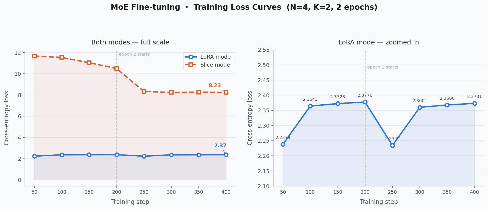
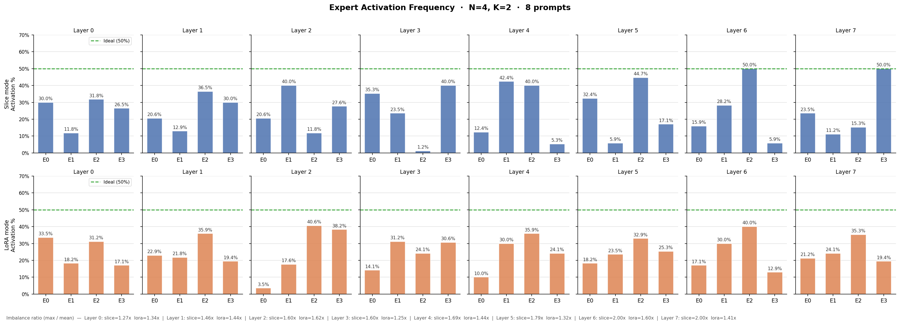

# Efficient Llama Inference: INT4 Quantization and Sparse MoE

A compact PyTorch implementation of two techniques for improving large language
model inference:

- **INT4 weight-only quantization** with per-group affine quantization and bit
  packing
- **Sparse Mixture-of-Experts (MoE)** feed-forward layers with top-k routing,
  including sliced experts and parameter-efficient LoRA experts

The project uses **Llama 3.2-1B** and focuses on the full systems workflow:
implementing custom layers, converting a pretrained model, validating numerical
behavior, fine-tuning sparse experts, and measuring memory, latency, perplexity,
and routing balance.

> This is a reference research implementation. The INT4 and MoE paths use
> straightforward PyTorch operations to make the algorithms easy to inspect;
> they are not replacements for fused production kernels.

## Highlights

- Packed two 4-bit weights into each `torch.uint8` value using per-group
  scales and zero points (`group_size=128`).
- Reduced the measured model footprint from **2858.13 MB to 1127.21 MB**
  (**60.57% reduction**).
- Replaced dense Llama feed-forward blocks with **4-expert, top-2 MoE** layers.
- Implemented a **zero-initialized LoRA-MoE** whose output matches the dense
  model at initialization.
- Fine-tuned only **2.23M parameters (~0.15%)** in LoRA-MoE while preserving
  dense-model perplexity (**9.60 vs. 9.66**).
- Profiled why compact model storage does not automatically translate into
  faster inference without fused dequantization and expert-dispatch kernels.

## Results

Benchmarks were collected on an NVIDIA A40 using Llama 3.2-1B in FP16. Latency
and memory values can vary with the CUDA, PyTorch, and driver versions.

### INT4 weight-only quantization

| Model representation | Measured size | Relative size | Reduction |
|---|---:|---:|---:|
| FP16 baseline | 2858.13 MB | 100.00% | — |
| Packed INT4 model | 1127.21 MB | 39.43% | 60.57% |

Benchmark configuration: input length 256, output length 32.

| Precision | Batch size | Peak memory | Runtime |
|---|---:|---:|---:|
| FP16 | 1 | 3072 MB | 0.83 s |
| INT4 | 1 | 3028 MB | 1.63 s |
| FP16 | 8 | 4495 MB | 0.65 s |
| INT4 | 8 | 3997 MB | 1.82 s |
| FP16 | 16 | 6134 MB | 0.75 s |
| INT4 | 16 | 5110 MB | 2.02 s |

The packed representation saves memory, particularly as the batch grows, but
this reference implementation is slower than FP16. Each forward pass unpacks
the weights, reconstructs a full FP16 tensor, and then calls a standard matrix
multiplication. That adds conversion work and extra memory traffic. A fused
dequantize-and-matmul kernel would consume packed weights directly and avoid
materializing the intermediate FP16 matrix.

### Mixture-of-Experts

Both variants use 4 experts and activate the top 2 for each token. LoRA experts
use rank 8.

| Metric | Dense baseline | MoE-Slice | MoE-LoRA |
|---|---:|---:|---:|
| Total parameters | 1,498,482,688 | 1,498,613,760 | 1,500,710,912 |
| Trainable parameters | 1,498,482,688 | 131,072 | 2,228,224 |
| Peak memory | 3071.57 MB | 3072.14 MB | 3080.14 MB |
| Inference time | 0.76 s | 1.18 s | 1.25 s |
| Held-out perplexity | 9.66 | 3227.23 | **9.60** |
| Next-token accuracy | 51.36% | 4.36% | **51.55%** |

The slice experiment shows the cost of routing tokens through reduced-width
fragments of a pretrained FFN: with a small fine-tuning set, the router could
not recover the lost capacity. LoRA-MoE retains the frozen dense FFN as a
quality floor and learns small routed residuals, preserving the baseline while
training only a small fraction of the model.

#### Training behavior



#### Expert utilization



The load-balance study found average max-to-mean expert activation ratios of
approximately **1.65× for slice mode** and **1.43× for LoRA mode** across the
sampled layers. LoRA's zero initialization gives its experts an equivalent
starting point, which helped keep routing more balanced during the short
fine-tuning run.

## How It Works

### INT4 quantization

`QuantizedLinear` converts each pretrained `nn.Linear` weight matrix using
group-wise affine quantization:

1. Reshape weights into groups of 128 values.
2. Compute one scale and zero point per group.
3. Quantize each value into the unsigned range `[0, 15]`.
4. Pack adjacent 4-bit values into a single `uint8` buffer.
5. Unpack and dequantize to FP16 during the forward pass before `F.linear`.

`quantize_model()` recursively replaces the model's dense linear layers with
the packed implementation.

### MoE-Slice

Each pretrained FFN is divided into four contiguous, reduced-width experts.
For every token, a learned linear router selects two experts, renormalizes their
gate weights, and combines their outputs. The sliced expert weights together
preserve the dense FFN parameter budget; only the routers are fine-tuned in the
default configuration.

### MoE-LoRA

The original FFN is retained and frozen. Four low-rank adapters act as routed
experts:

```text
output = frozen_ffn(x) + Σ gate_i · LoRA_i(x),  i ∈ top-k
```

Each expert contains an `A: d → r` projection and a `B: r → d` projection.
`B` is initialized to zero, so all adapter outputs are initially zero and the
converted model begins with the same behavior as the dense model. Only the
routers and adapter parameters are trained.

## Repository Structure

```text
.
├── inference.py             # Text-generation smoke test
├── benchmark_inference.py   # Single-configuration FP16 benchmark
├── run_benchmark.py         # FP16, INT4, and MoE comparisons
├── verify_implementation.py # Structural and numerical checks
├── train_moe.py             # Slice/LoRA MoE fine-tuning
├── eval_moe.py              # Perplexity, accuracy, and throughput evaluation
├── prepare_data.py          # Alpaca and MT-Bench data preparation
├── requirements.txt
├── llama/
│   ├── generation.py        # Autoregressive generation
│   ├── model.py             # Llama architecture
│   ├── moe.py               # Routers, experts, and model conversion
│   ├── quantize.py          # INT4 packing and QuantizedLinear
│   └── tokenizer.py
└── results/
    ├── moe/                  # Loss and routing visualizations
    └── quantization/         # Quantization outputs and measurements
```

## Setup

### Requirements

- Python 3.11+
- PyTorch 2.6+
- CUDA-capable NVIDIA GPU recommended
- Access to Llama 3.2-1B weights and tokenizer

Install the Python dependencies:

```bash
pip install -r requirements.txt
```

Download Llama 3.2-1B through an authorized source. One option is the Meta
Llama CLI:

```bash
pip install llama-stack
llama model download --source meta --model-id Llama3.2-1B
```

By default, scripts load model files from `checkpoints/Llama3.2-1B` and data
from `data`. Override either location with `LLAMA_CHECKPOINT_DIR` or
`LLAMA_DATA_DIR`. To regenerate the evaluation/fine-tuning data:

```bash
pip install datasets
python prepare_data.py --output-dir ./data
```

## Usage

### Run a generation smoke test

```bash
python inference.py
```

### Benchmark FP16 and INT4

```bash
python benchmark_inference.py
python run_benchmark.py
```

### Verify the implementations

```bash
python verify_implementation.py
```

### Train and evaluate MoE-Slice

```bash
python train_moe.py --init-mode slice
python eval_moe.py --init-mode slice
```

### Train and evaluate MoE-LoRA

```bash
python train_moe.py --init-mode lora
python eval_moe.py --init-mode lora
```

The fine-tuned checkpoint is written to `checkpoints/moe_finetuned.pt` by
default. Run `python run_benchmark.py` after training to generate the complete
comparison.

## Engineering Takeaways

- **Compression is not the same as acceleration.** Packed weights reduce model
  storage, but speedup requires kernels that avoid reconstructing and rereading
  a full-precision weight matrix.
- **Initialization determines whether sparse adaptation is stable.** Slicing a
  pretrained FFN immediately changes its function; zero-initialized LoRA
  experts preserve it exactly at conversion time.
- **Sparse models need efficient dispatch.** Python loops over small token
  subsets underutilize the GPU. Production MoE implementations group tokens by
  expert and use fused or grouped matrix multiplications.
- **Routing must be monitored.** Top-k selection alone does not ensure balanced
  expert utilization; auxiliary load-balancing objectives are important for
  larger training runs.

## Limitations and Next Steps

- Fuse INT4 dequantization with matrix multiplication using Triton or a custom
  CUDA kernel.
- Compare naive affine INT4 with calibration-aware methods such as GPTQ and AWQ.
- Quantize the KV cache to reduce memory growth at long sequence lengths.
- Replace Python expert dispatch with grouped GEMM and add an auxiliary
  load-balancing loss.
- Evaluate on larger instruction-tuning and language-modeling datasets with
  multiple seeds.

## Acknowledgments

The Llama model implementation is based on Meta's
[official Llama 3 codebase](https://github.com/meta-llama/llama3).
